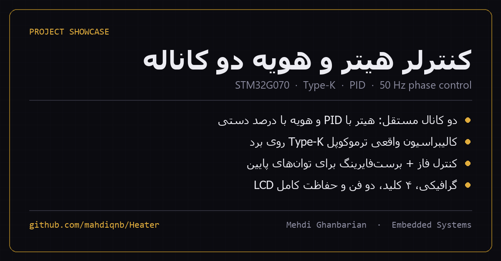
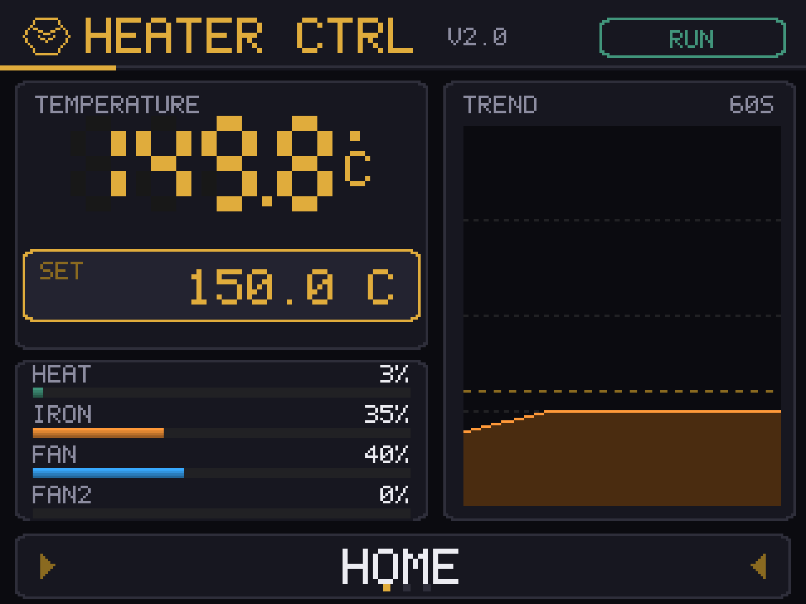
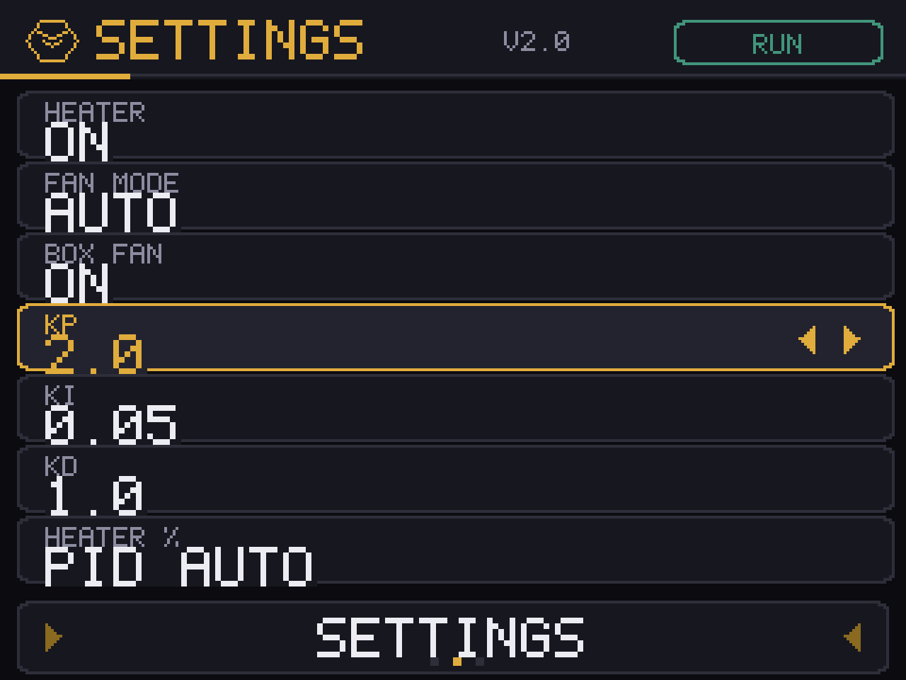
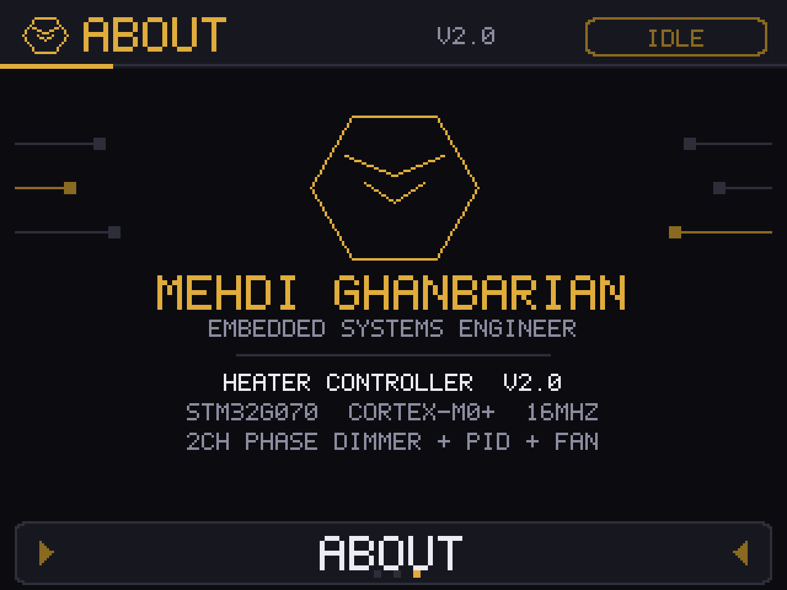
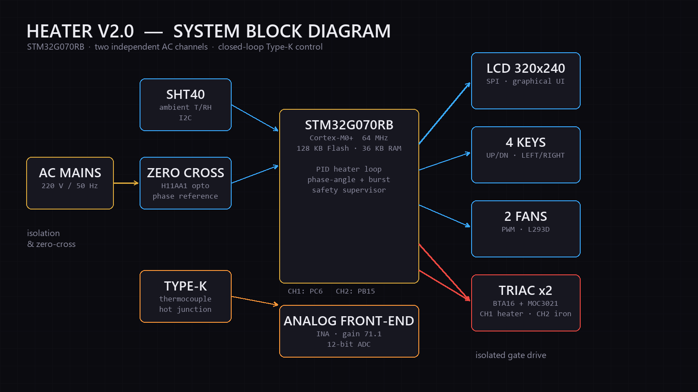

<p align="center">
  
</p>

<h1 align="center">HEATER V2.0</h1>
<p align="center"><b>کنترلر هیتر و هویه دو کاناله · Two-channel heater &amp; soldering-iron controller</b><br>
STM32G070RB · Type-K · PID · 50 Hz phase-angle dimmer · 320×240 LCD</p>

---

<div dir="rtl">

## 🔥 این پروژه چیست؟

یک کنترلر کامل برای **یک هیتر ۲۲۰ ولت با حلقه بسته PID** و **یک هویه با توان دستی**، هر دو روی یک برد و با یک میکروکنترلر. دمای هیتر با ترموکوپل Type-K خوانده می‌شود، توان المنت با کنترل فاز روی برق شهر تنظیم می‌شود و همه‌چیز از یک LCD گرافیکی ۳۲۰×۲۴۰ و چهار کلید اداره می‌شود.

هدف اصلی این بود که دما واقعاً **ثابت بماند**، نه اینکه فقط روی نمایشگر عدد قشنگ نشان بدهد. برای همین بیشتر کار روی اندازه‌گیری درست ترموکوپل، حذف نویز سوئیچینگ تریاک و پایداری حلقه کنترل صرف شده است.

## ✨ امکانات

- **دو کانال مستقل AC:** کانال ۱ (هیتر) با PID و کانال ۲ (هویه) با درصد دستی ۰ تا ۱۰۰.
- **اندازه‌گیری واقعی Type-K:** تقویت‌کننده INA826، جبران اتصال سرد با دمای محیط SHT40 و تبدیل با چندجمله‌ای معکوس NIST ITS-90 (۰ تا ۵۰۰ درجه).
- **تفکیک توان ۰٫۰۱٪:** زیر ۲۰٪ از روش burst firing (نیم‌سیکل کامل روشن/خاموش) و بالای آن از کنترل فاز استفاده می‌شود؛ بالای ۸۰٪ گیت تریاک ممتد روشن می‌ماند.
- **همگام‌سازی مقاوم با صفر کراس:** شبکه زمانی مستقل از TIM3 که فقط با صفر کراس واقعی قفل می‌شود؛ پالس‌های تقلبی ناشی از فایر شدن تریاک دیگر باعث قطع کانال دیگر نمی‌شوند.
- **PID صنعتی:** ددبند ±۲ درجه، مشتق روی اندازه‌گیری (نه روی خطا)، ضد windup و محدودیت نرخ تغییر خروجی.
- **حفاظت کامل:** قطع خودکار در دمای ۴۰ درجه بالاتر از setpoint (سه نمونه متوالی) یا بالای ۵۲۰ درجه، تشخیص ترموکوپل قطع/شورت با مقایسه با دمای محیط، و نمایش وضعیت روی LCD و LED خطا.
- **تشخیص قطع برق:** بدون صفر کراس، تریاک‌ها فایر نمی‌شوند و UI وضعیت `NO AC` را نشان می‌دهد.
- **دو فن با PWM:** فن هیتر در حالت AUTO با روشن شدن المنت حداقل ۴۰٪ می‌چرخد؛ فن کمکی روی ریل ۲۴ ولت به ۵۰٪ محدود شده و حالت MUTE دارد.
- **رابط کاربری گرافیکی:** سه صفحه HOME / SETTINGS / ABOUT، فونت ۵×۷ اختصاصی، نمودار روند ۶۰ ثانیه‌ای و تنظیمات ذخیره‌شده در فلش.
- **کلیدهای هوشمند:** تک‌ضربه، تکرار خودکار هنگام نگه‌داشتن و گام بزرگ‌تر برای نگه‌داشتن طولانی.

## 🖥 رابط کاربری

| صفحه اصلی | تنظیمات |
|---|---|
|  |  |

| درباره | دیاگرام سیستم |
|---|---|
|  |  |

> تصاویر UI با همان فونت ۵×۷ و همان مختصات دقیق `Core/Src/ui.c` رندر شده‌اند، بنابراین همان چیزی هستند که روی نمایشگر دستگاه دیده می‌شود.

## 🔧 مشخصات سخت‌افزار

| بخش | قطعه / مشخصه |
|---|---|
| میکروکنترلر | STM32G070RB — Cortex-M0+، ۶۴ مگاهرتز (HSI + PLL)، ۱۲۸ کیلوبایت فلش، ۳۶ کیلوبایت RAM |
| نمایشگر | ILI9341، ۲٫۲ اینچ، ۳۲۰×۲۴۰، رابط SPI1 |
| کلیدها | چهار کلید tact روی PC0..PC3 (active-low) |
| ورودی دما | ترموکوپل Type-K + INA826 (بهره اندازه‌گیری‌شده ۷۱٫۱۲)، ADC 12-bit روی PA0 |
| دمای محیط / اتصال سرد | SHT40 روی I2C1 |
| دیمر AC | دو کانال BTA16 + MOC3021 — CH1: PC6، CH2: PB15 |
| صفر کراس | H11AA1 روی PC7 (EXTI) |
| فن‌ها | دو فن با L293D و PWM — TIM1_CH1 (PC8) و TIM17_CH1 (PB9) |
| LEDها | CH1: PB13، CH2: PB12، ERR: PB14 (active-low) |
| ذخیره تنظیمات | آخرین صفحه فلش در آدرس `0x0801F800` |

## 📁 ساختار مخزن

```
HEATER V2.0/
├─ Core/
│  ├─ Inc/            هدرها: ui, control, dimmer, temp, fan, keys, lcd, settings, font5x7, logo
│  └─ Src/            main.c و ماژول‌های برنامه
├─ Drivers/           CMSIS + STM32G0 HAL
├─ hardware/          فایل Altium، PDF شماتیک، BOM
├─ docs/images/       تصاویر UI، دیاگرام و کاور
├─ tools/             اسکریپت‌های ساخت فونت و پیش‌نمایش UI
├─ HEATER V2.0.ioc    پروژه CubeMX
├─ STM32G070RBTX_FLASH.ld
└─ README.md
```

## 🛠 ساخت و پروگرام

1. پوشه پروژه را در **STM32CubeIDE** با `File → Import → Existing Projects into Workspace` باز کنید.
2. کانفیگ `Debug` را build کنید (آیکون چکش).
3. با یک **ST-LINK** روی پین‌های SWD پروگرام کنید.

> ⚠️ موقع پروگرام کردن، برق ۲۲۰ ولت برد را **قطع** کنید. فقط ۳٫۳ ولت SWD و GND وصل باشد.

## 📄 فایل‌های سخت‌افزاری

- [شماتیک کامل (PDF)](hardware/My%20Heater.pdf)
- [فایل PCB در Altium](hardware/My%20heater.PcbDoc)
- [لیست قطعات (BOM)](hardware/BOM/My%20Heater%20BOM.xlsx)

## ⚠️ هشدار ایمنی

این برد مستقیماً با **برق شهر ۲۲۰ ولت** کار می‌کند. تست، مونتاژ و استفاده از آن فقط با رعایت اصول ایمنی و توسط فرد آشنا به برق قدرت انجام شود. هیچ‌وقت برد را در حالی که به برق وصل است لمس نکنید.

## 👤 نویسنده

**Mehdi Ghanbarian** — Embedded Systems Engineer
GitHub: [@mahdiqnb](https://github.com/mahdiqnb)

</div>

---

## 🔥 What is this?

A complete controller for a **220 V heater with a closed-loop PID** and a **soldering iron with manual power**, both on one board and one microcontroller. The heater temperature comes from a Type-K thermocouple, the element power is set by phase-angle control on the mains, and everything is operated from a 320×240 graphical LCD and four keys.

The real goal was to make the temperature actually **stay put**, not just look nice on the display. Most of the work therefore went into an accurate thermocouple front end, removing triac switching noise, and making the control loop stable.

## ✨ Features

- **Two independent AC channels:** channel 1 (heater) closed-loop PID, channel 2 (iron) manual 0–100 % duty.
- **Real Type-K measurement:** INA826 front end, cold-junction compensation from the SHT40 ambient sensor, NIST ITS-90 inverse polynomial (0–500 °C).
- **0.01 % power resolution:** burst firing below 20 % (whole half-cycles on/off), phase-angle control above it, and a continuously held gate above 80 %.
- **Zero-cross robust:** a free-running TIM3 half-cycle grid that is only re-locked by real zero-cross edges, so firing one triac can no longer cancel the other channel.
- **Practical PID:** ±2 °C dead-band, derivative on measurement (no setpoint kick), conditional-integration anti-windup and output slew limiting.
- **Full protection:** trip at setpoint + 40 °C for three consecutive samples or above 520 °C, open/short thermocouple detection against ambient, LCD status and error LED.
- **Mains-loss detection:** no zero-cross means no firing, and the UI shows `NO AC`.
- **Two PWM fans:** the heater fan follows the heater in AUTO with a 40 % floor; the auxiliary fan is hard-clamped to 50 % on the 24 V rail and has a MUTE mode.
- **Graphical UI:** HOME / SETTINGS / ABOUT pages, custom 5×7 font, 60-second trend graph, settings persisted in flash.
- **Smart keys:** single press, auto-repeat when held, and a larger step for long holds.

## 🖥 User interface

The UI images above are rendered with the firmware's own 5×7 font and the exact layout constants from `Core/Src/ui.c`, so they show what the device actually displays.

## 🔧 Hardware

| Part | Device / spec |
|---|---|
| MCU | STM32G070RB — Cortex-M0+, 64 MHz (HSI + PLL), 128 KB flash, 36 KB RAM |
| Display | ILI9341, 2.2", 320×240, SPI1 |
| Keys | four tactile switches on PC0..PC3 (active-low) |
| Temperature input | Type-K thermocouple + INA826 (measured gain 71.12), 12-bit ADC on PA0 |
| Ambient / cold junction | SHT40 on I2C1 |
| AC dimmer | two channels, BTA16 + MOC3021 — CH1: PC6, CH2: PB15 |
| Zero-cross | H11AA1 on PC7 (EXTI) |
| Fans | two fans via L293D and PWM — TIM1_CH1 (PC8), TIM17_CH1 (PB9) |
| LEDs | CH1: PB13, CH2: PB12, ERR: PB14 (active-low) |
| Settings storage | last flash page at `0x0801F800` |

## 📁 Repository layout

```
HEATER V2.0/
├─ Core/
│  ├─ Inc/            ui, control, dimmer, temp, fan, keys, lcd, settings, font5x7, logo
│  └─ Src/            main.c and the application modules
├─ Drivers/           CMSIS + STM32G0 HAL
├─ hardware/          Altium PCB, schematic PDF, BOM
├─ docs/images/       UI mockups, block diagram, cover
├─ tools/             font generator and UI preview scripts
├─ HEATER V2.0.ioc    CubeMX project
├─ STM32G070RBTX_FLASH.ld
└─ README.md
```

## 🛠 Build & flash

1. Open the folder in **STM32CubeIDE** with `File → Import → Existing Projects into Workspace`.
2. Build the `Debug` configuration.
3. Flash with an **ST-LINK** over SWD.

> ⚠️ Disconnect the 220 V mains while flashing. Only 3.3 V SWD and GND should be connected.

## 📄 Hardware files

- [Full schematic (PDF)](hardware/My%20Heater.pdf)
- [Altium PCB](hardware/My%20heater.PcbDoc)
- [Bill of materials](hardware/BOM/My%20Heater%20BOM.xlsx)

## ⚠️ Safety

This board works directly with **220 V mains**. Build, test and use it only with proper safety practices and by someone experienced with mains power. Never touch the board while it is connected to the mains.

## 👤 Author

**Mehdi Ghanbarian** — Embedded Systems Engineer
GitHub: [@mahdiqnb](https://github.com/mahdiqnb)
